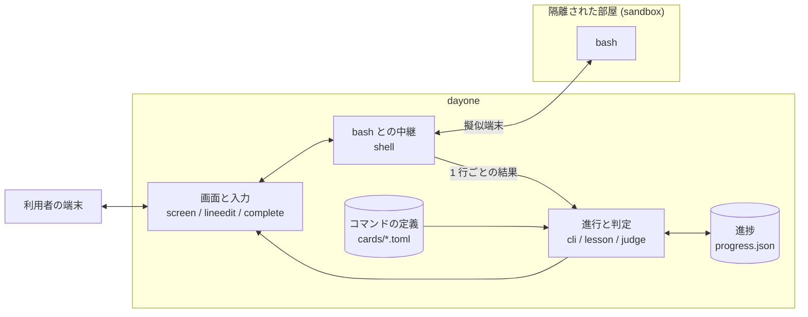

# day-one

コマンドを 1 つずつ、実際に打って覚えるターミナルアプリです。
コマンド 1 つごとに、「説明を読む → 打ってみる → お題を解く」を 1〜2 分で回します。
どんなコマンドがあり、何をするもので、いつ使うと便利なのかを、手を動かしながら知るためのものです。

Ubuntu(Windows の WSL2 上の Ubuntu を含む)で動きます。
障害対応ゲーム [oncall](../oncall) に進む前の、最初の一歩という位置づけです。
vim のキー操作を続けて練習するための姉妹アプリ [home-row](../home-row) も構想中です(まだ実装はありません)。

## 初回のセットアップ

このディレクトリで、最初に 1 回だけ実行します。

```bash
python3 -m venv .venv
.venv/bin/pip install -e '.[dev]'
ln -sf "$PWD/.venv/bin/dayone" ~/.local/bin/dayone
```

専用の Python 環境を `.venv` に作り、そこへこのアプリと必要なライブラリを入れます。
最後の行は、どのディレクトリからでも `dayone` で起動できるようにするためのものです。
`.venv` を消したときや、別の PC に移したときは、もう一度実行してください。

## 起動

```bash
dayone
```

どのディレクトリで実行しても構いません。動作は同じで、実行したディレクトリのファイルには触れません
(詳しくは「ファイルが作られる場所」)。

`dayone` だけなら、いまの端末で、通常のデザインのまま起動します。

### レトロなデザインで使う(Windows Terminal)

最初に 1 回だけ、準備をします。Windows Terminal に「day-one」というプロファイルが 1 つ増えます(ほかのプロファイルは変わりません)。

```bash
dayone --retro-install
```

それ以降は、次のコマンドで、レトロなデザインの新しいタブが開いて起動します。

```bash
dayone --retro
```

レトロのデザインは、通常のデザインとは別に作ってあります。緑一色のブラウン管の端末を手本にしていて、
色は緑の濃淡だけ(背景に色は付けません)、記号と枠は `*` `#` `+--+` のような文字だけを使い、ロゴも別のものです。
フォント(MS Gothic)、背景の色、走査線、カーソルの高さは、プロファイルが設定します。

| やりたいこと | コマンド |
|---|---|
| 通常のデザインで動かす | `dayone` |
| レトロなデザインで動かす | `dayone --retro` |
| レトロ用のプロファイルを取り除く | `dayone --retro-remove` |

フォントや色味は、アプリではなく端末の設定で決まります。そのため、見た目を変えるには専用のタブで開く必要があります。

2 つのデザインは、別々のファイルに入っています。片方を変えても、もう片方は変わりません。

| デザイン | ファイル |
|---|---|
| 通常 | `src/dayone/designs/normal.py` |
| レトロ | `src/dayone/designs/retro.py`(フォントなど端末の設定もここ。変えたあとは `dayone --retro-install` で反映) |

## 使い方

初めて起動したときは、最初にチュートリアル(4 ページ)が出ます。Enter で次のページへ進み、最後のページの Enter でトップページに移ります。
2 回目からは出ません。もう一度見たいときは、トップページで `tutorial` と打ちます。

起動すると、トップページ(コマンドの一覧)が出ます。コマンドを選んで練習し、終えたら次のコマンドへ進むかトップページに戻ります。

どの場面でも、`title` はトップページに戻る、`exit` はアプリを終了する、という意味です。

### トップページ(コマンド一覧)

```
╭─ コマンド一覧 ────────────────────────────────────────────────────────────────────────╮
│   場所と移動  ■■□  2/3                     中身を見る  □□□□  0/4                      │
│     1 ✓ ◆ pwd   いまいる場所を表示する       4   ◆ cat   ファイルの中身を表示する     │
│     2 ! ◆ ls    ファイルの一覧を表示する     5   ◆ head  ファイルの先頭だけを表示する │
│     3   ◆ cd    別のディレクトリへ移動する   6   ◆ tail  ファイルの末尾だけを表示する │
│                                                                                       │
│                                 ページ 1/4                                            │
│                                 ← → で移動                                            │
╰───────────────────────────────────────────────────────────────────────────────────────╯
  おぼえたコマンド   5%  ━━━━━━━━━━━━━━━━━━━━  2/38   今日の復習 1 個
◆ oncall への準備   16%  ━━━━━━━━━━━━━━━━━━━━  2/12

  ✓ おぼえた  ! 復習どき  ◆ oncall で使う

── Enter 復習 ls │ ← → ページ │ tutorial 使い方 │ exit 終了 ─
> Enter / コマンドを入力(例: cd)        ← 何も打っていないあいだ、薄く出る案内
```

| 操作 | 働き |
|---|---|
| Enter | おすすめのコマンドを開く(復習の時期が来たもの、なければ次の新しいコマンド) |
| コマンドを打って Enter | そのコマンドを開く(`ls`、`cat`、`vim-edit` など、一覧に出ている名前) |
| ← → | 前後のページへ移る(1 画面に収まらないときだけ) |
| `tutorial` | チュートリアル(使い方の案内)を見る |
| `exit` | 終了する |

「コマンド一覧」の枠で囲まれた部分(コマンドの一覧とページの案内)が、← → でページを送ると変わる部分です。
枠の外(ロゴ、進み具合のバー、印の説明)は、どのページでも同じです。

通常のデザインでは、色は種類ごとに分けてあり、どの画面でも同じ意味です。水色が打つもの(コマンドの名前)、紫が見出し、緑ができたこと、赤が復習に関するもの、黄がヒントと指摘です。

コマンドの左の印は、そのコマンドをどこまで覚えたかを表します。

| 印 | 一覧の下の呼び名 | 意味 |
|---|---|---|
| (なし) | — | まだお題に正解していないコマンド |
| ✓(緑) | おぼえた | お題に正解したコマンド。次の復習の日まではこの印です |
| !(赤) | 復習どき | おぼえたあと、復習の日が来たコマンド。復習して正解すると `✓` に戻ります |
| ◆(青) | oncall で使う | 障害対応ゲーム oncall を始める前に覚えておきたいコマンド(12 個)。下の「oncall への準備」のバーは、この印が付いたものを覚えると進みます |

「復習どき」のコマンドは、復習するまで `!` のままです。一覧で Enter を押すと、復習の日がいちばん古いものから出題されます。
復習の日の決まり方は「進捗と復習」にあります。

番号は何番目かを示すもので、番号を打ってもコマンドは開きません(以前、終了のキーだった `q` と `1` の押し間違いが起きたためです)。

一覧の下の 2 本のバーは、全体の進み具合です。見出しの右の数字が進捗度(%)で、バーは左からその割合だけ緑になります。

- **おぼえたコマンド**: 全コマンドのうちいくつを覚えたか。今日復習するコマンドがあれば、右に「今日の復習 1 個」と赤で出ます。
- **oncall への準備**: oncall を始める前に覚えておきたい 12 個のうちいくつを覚えたか。

端末の幅が 80 桁以上あれば 2 列に並びます。

### 練習の途中

画面は上から 3 つに分かれています。

```
(表示: コマンドの説明、打ったコマンドとその結果がここに流れます)

─ ls ──── hint ヒント │ card 説明 │ title トップページに戻る │ exit 終了 ─  ← 左: 練習中のコマンド / 右: 使える操作
~ $ ls -l                                      ← 入力欄: ここに打ちます
────────────────────────────────────────────
 ▶ 打ってみよう 2/3  ●●○☆                      ← ステータスバー
   名前だけでなく詳しい情報も見られます。ls -l と打ってみましょう。
   ヒント ls -l と打ってみましょう。
```

ステータスバーには、いま取り組むことが出たままになります。コマンドの結果が流れても、ここは動きません。

- **お題**: 「打ってみよう」や「お題」の文章です。
- **進み具合**: 見出しの `●●○☆` は、試し打ちの 1 手が ●、お題が ★ です。段階が進むと、次のコマンドを打つまで見出しが目立つ表示になります。
- **ヒント**: `hint` で開いたヒントは、ここに出たままになります。
- **直前の指摘**: 「出力が違うようです」などの指摘は、次のコマンドを打つまでここに出ます。

練習は「説明 → 打ってみよう → お題」の順に進みます。打ったコマンドは本物の bash で実行されます。

- **打ってみよう**: 案内されたコマンドを打つと次へ進みます。ほかのコマンドを自由に試しても構いません。
- **お題**: 結果が合っていて、練習中のコマンドを使っていれば正解です。書き方は 1 通りでなくても通ります。
  お題の中身(ファイル名や移動先など)は、コマンドを開くたびに変わります。

| 打つ言葉 | 働き |
|---|---|
| `hint` | ヒントを 1 つ開く |
| `card` | コマンドの説明をもう一度表示する |
| `title` | 練習をやめて、トップページに戻る(進捗は変わらない) |
| `exit` | アプリを終了する |

`less` や `vim` を開いているあいだは、入力欄に閉じ方(「q で閉じる」など)が出ます。

### 練習を終えたあと

お題に正解すると、ステータスバーに次の一手が出ます。Enter で次のコマンドへ進み、`r` で同じコマンドをもう一度、`title` でトップページに戻り、`exit` で終了します。
コマンドを開くときとトップページに戻るときは、前の表示を消してから次の内容を出します。

`hint`・`card`・`title` は、Linux のコマンドと重ならない名前を選んであります。練習の中で打っても、本物のコマンドとぶつかりません。

## コマンドの一覧

全部で 38 個あります。「絞り込む・数える」から「スクリプトを書く準備」までの 5 つの分類は、
障害対応ゲーム oncall のインシデントで使うコマンドをそろえたものです。

| 分類 | コマンド |
|---|---|
| 場所と移動 | pwd / ls / cd |
| 中身を見る | cat / head / tail / less |
| 作る・動かす・消す | mkdir / touch / cp / mv / rm |
| 出力とつなぎ方 | echo / `>`(リダイレクト)/ `\|`(パイプ) |
| 絞り込む・数える | grep / sort / uniq / awk / wc / cut |
| ファイルを探す・守る | find / du / chmod / xargs |
| 書き換える・比べる | sed / diff / comm / join |
| プロセスを調べる・止める | ps / kill |
| スクリプトを書く準備 | test / bash |
| 調べる | `--help` / man / which |
| ファイルを編集する | vim(開く・書く・保存する)/ vim-edit(vim で文字や行を消す) |

## 進捗と復習

お題に正解すると「おぼえた」になり、翌日に復習として再び出題されます。
復習では説明と試し打ちを飛ばし、中身を変えたお題だけを出します。
ヒントなし・間違いなしで解けると定着度が上がり、次の復習までの間隔が 1 日 → 3 日 → 7 日 → 14 日 → 30 日と延びます。
ヒントを使ったり間違えたりした場合は、定着度が最初に戻って翌日また出題されます(寄り道のコマンドは間違いに数えません)。
定着度(●の数)と次の復習の時期は、お題に正解したときに表示されます。一覧には、おぼえたかどうかの印だけが出ます。

一覧の下の「oncall への準備」は、oncall を始める前に覚えておきたい 12 個(pwd、ls、cd、cat、head、tail、`>`、`|`、grep、sort、uniq、awk)の進み具合です。
最後の 4 つは、oncall の最初のインシデント「深夜の 500 祭り」で、ログを絞り込んで数えるのに使います。
2 つ目以降のインシデントで使うコマンドも、すべて一覧にあります。印は付きませんが、おぼえたときに「oncall の「…」で使います」と案内が出ます。
oncall のミッションで使うコマンドを覚えたときは、どのミッションで使うかも案内します。
この対応は `src/dayone/oncall.toml` に書いてあります。

セーブデータは `~/.local/share/dayone/progress.json` に保存されます
(`XDG_DATA_HOME` や `DAYONE_DATA_DIR` で場所を変えられます)。
`dayone --reset-progress` で消せます。消す前に確認があり、`y` と答えたときだけ消します。

## ファイルが作られる場所

どのディレクトリで `dayone` を実行しても、動作も、ファイルが作られる場所も同じです。
実行したディレクトリにファイルが作られたり、そこのファイルが書き換えられたりすることはありません。

| 何が | どこに |
|---|---|
| 練習用のファイル | `/tmp/dayone-xxxx/`(コマンドを開くたびに作り、練習を終えると消します) |
| セーブデータ | `~/.local/share/dayone/progress.json` |
| アプリ本体とライブラリ | このディレクトリの `.venv/` |
| `dayone` コマンド | `~/.local/bin/dayone`(`.venv/bin/dayone` へのリンク) |
| レトロな見た目の設定 | Windows Terminal の設定ファイル `settings.json`(`dayone --retro-install` を実行したときだけ。プロファイルと配色を 1 つずつ足します) |
| 上の設定ファイルの控え | 同じ場所の `settings.json.before-day-one`(初めて書き換える前の内容) |

## 実行方式

打ったコマンドは本物の bash で実行されます。色や複数列の表示、`less` や `man`、`vim` のような画面全体を使うコマンドもそのまま動きます。

入力欄での行の編集はアプリが行います。←→ での移動、↑↓ での履歴、Ctrl-A / Ctrl-E / Ctrl-U などが使えます。
Tab キーを押すと、打ちかけのファイル名やコマンド名を補います(`cat me` で Tab → `cat memo.txt`)。
候補が複数あるときは、共通する部分まで補い、それ以上は候補の一覧を表示します。

- **隔離モード**: `unshare` で名前空間を分け、`/usr`・`/etc` と練習用の場所だけが見える環境で動かします。
  何を打っても本来の環境は変わりません。仕組みは [docs/isolation.md](docs/isolation.md) にまとめています。
- **簡易モード**: 名前空間を作れない環境で自動的に選ばれます。使い捨てディレクトリをホームにし、
  その外への `cd` や、外のファイルを書き換えるコマンドを止めます。入力ミスによる事故を防ぐためのもので、
  完全な隔離ではありません。

2 つの違いは次のとおりです。練習の内容と進み方は、どちらでも同じです。

| | 隔離モード | 簡易モード |
|---|---|---|
| 守り方 | 練習用の場所しか存在しない環境を作る | 本来の環境の上で、危ない操作を見つけて止める |
| 本来のホームや Windows 側のファイル | 見えない(存在しない) | 読むことはできる。書き換えと削除は止める |
| 練習用の場所の外への `cd` | できる(`/usr` や `/etc` を見に行ける) | できない |
| ほかのプロセス | 見えない | 見える。`kill` できるのは練習の中で起動したものだけ |
| ネットワーク | つながらない | つながる |
| `sudo`・`pkill`・`pushd` など | そのまま打てる(外には影響しない) | 使えない |
| `pwd` で出るホームの場所 | `/home/ユーザー名` | `/tmp/dayone-xxxx/home` |
| 安全さ | 何を打っても本来の環境は変わらない | 入力ミスは防ぐが、意図的な回避までは防げない |

隔離モードを使えない環境では、始める前に「隔離モードで実行できなかったので、簡易モードで実行します。よろしいですか?」と確認が出ます。
`y` と答えたときだけ、簡易モードで始まります(`--mode guard` を自分で指定したときは、確認は出ません)。

通常のデザインでは、いまどちらで動いているかがトップページのロゴの下に出ます(「隔離モードで実行中」)。
レトロのデザインでは、ロゴの下の 2 行(ひとことの説明と、実行方式)を出しません。
`dayone --mode isolated` / `dayone --mode guard` で明示的に選べます。

## コマンドの追加

`src/dayone/cards/` に TOML ファイルを 1 つ置くと、ファイル名の順に一覧へ並びます。
`command` は一覧で打って選ぶ名前になるので、ほかと重ならない、打ちやすい名前にします。

```toml
command = "cat"
category = "中身を見る"
title = "ファイルの中身を表示する"
summary = "ファイルの中身を、最初から最後までそのまま画面に出します。"
when = "短いファイルの中身をさっと確かめたいとき。"
syntax = "cat [オプション] ファイル..."

[vars]                      # {{名前}} に入る候補。開くたびに選び直す
name = ["a.txt", "b.txt"]

[[files]]                   # 練習用のファイル (空のディレクトリは dirs = [...] で指定)
path = "memo.txt"
content = "牛乳を買う\n"

[[try]]                     # 試し打ち。run のコマンドを打つと次へ進む
say = "`cat memo.txt` と打ってみましょう。"
run = "cat memo.txt"
after = "中身が表示されました。"

[challenge]
ask = "`{{name}}` の中身を表示してください。"
solution = "cat {{name}}"    # お手本。これを実行した結果が正解になる
hints = ["…", "…"]
done = "正解したあとに出す一言"
```

お題の正解は、`solution` のコマンドを同じファイルの上で先に実行して求めます。
`check` で何を比べるかを選べます。

| check | 正解の条件 |
|---|---|
| `output`(既定) | 出力がお手本と同じ(色や列の並びの違いは無視) |
| `cwd` | いまいる場所がお手本と同じ |
| `files` | お手本と同じファイルが作られ・消され・書き換えられている(権限の変更も比べる) |
| `command` | お手本と同じコマンドを実行し、正常に終了した(`less` や `man` など、画面を使うコマンド用) |
| `process` | `target` に書いた名前のプロセスが、すべて止まっている(`kill` の練習用) |

どの場合も、`uses`(既定では、その定義の `command`)に挙げたコマンドを使っていることが条件です。
`try` と `challenge` に `before` を書くと、案内を出す前に、画面に出さずにそのコマンドを実行します。

`vim` のようにキー操作で結果が決まる試し打ちには `interactive = true` を付けます。正解を求めるときに、その手は実行されません。
この種類のお題では、`solution` を画面を使わない書き方にします(例: `vim -es -i NONE -c '…' -c wq ファイル`)。

`diff` のように、成功でも終了コードが 0 でないコマンドには、`status = [0, 1]` と書いて、成功とみなす終了コードを指定します。

長いファイルは、`content` の代わりに `lines = 100` と `line = "{n} 行目の内容"` を書くと、行番号を入れて自動で作れます。
復習ではお題だけを出すので、お題は試し打ちをしていない最初の状態からでも解けるように作ります。

## 仕組み

打ったコマンドを本物の bash で実行しながら、1 行ごとの結果を受け取って進行と判定を行います。



| 部分 | 役割 | 詳しい説明 |
|---|---|---|
| 全体 | モジュールの構成、起動から終了までの流れ、テストの考え方 | [docs/architecture.md](docs/architecture.md) |
| 画面と入力 | 端末を 3 つに分ける方法、一覧のページ分け、入力欄の行編集、Tab 補完 | [docs/terminal.md](docs/terminal.md) |
| bash との中継 | 擬似端末で bash を動かし、目印から 1 行ごとの結果を知る方法 | [docs/shell.md](docs/shell.md) |
| コマンドの定義と判定 | 定義の読み込み、お手本から正解を求める方法、判定の条件 | [docs/cards.md](docs/cards.md) |
| 進捗と復習 | 復習の間隔の決め方、セーブデータの形式 | [docs/progress.md](docs/progress.md) |
| 隔離 | 名前空間と `pivot_root` で部屋を作る手順 | [docs/isolation.md](docs/isolation.md) |

使っているのは Python 3.11 以上と [Rich](https://github.com/Textualize/rich) だけです。

## テスト

```bash
.venv/bin/pytest
```

全コマンドについて、お手本どおりに打てば正解になることを、実際のシェルで確かめます。
あわせて、アプリ全体を起動して、一覧からコマンドを開いて終了するまでの流れも確かめます。全部で 5 分ほどかかります。
