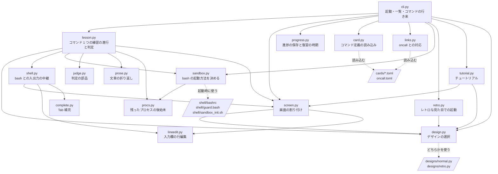
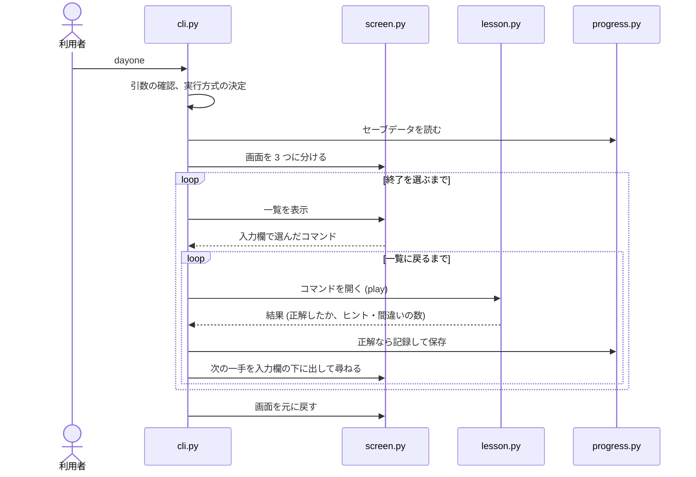
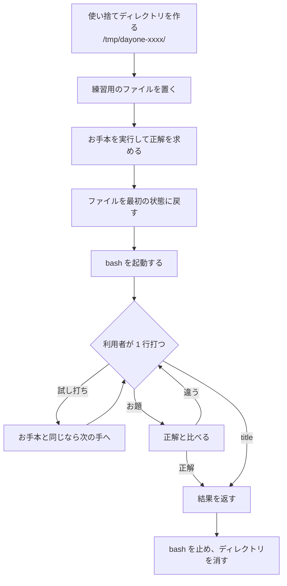

# 全体の構成

day-one がどんな部品でできていて、起動してから練習を終えるまでに何が起きるかをまとめます。
個々の仕組みの詳細は、末尾の「ほかのドキュメント」から読めます。

## 使っている技術

| 項目 | 内容 |
|---|---|
| 言語 | Python 3.11 以上(TOML の読み込みに標準の `tomllib` を使うため) |
| 外部ライブラリ | [Rich](https://github.com/Textualize/rich) のみ(色付きの表示、枠、文字幅の計算) |
| パッケージ | `pyproject.toml` + hatchling。`dayone` コマンドは `dayone.cli:main` を呼ぶ |
| シェル | 本物の bash を擬似端末(PTY)の上で動かす |
| 隔離 | Linux の名前空間(`unshare`)と `pivot_root` |
| テスト | pytest。全コマンドを実際のシェルで解いて確かめる |

画面の描画には TUI フレームワークを使っていません。端末の制御文字列(エスケープシーケンス)を直接書いています。
bash の出力をそのまま端末に流す必要があり、フレームワークの仮想画面を挟むと `less` や `vim`、色付きの出力を再現できないためです。

## モジュールの構成

`src/dayone/` の各ファイルの役割と、呼び出しの向きです。



大きく 4 つの層に分かれます。

| 層 | ファイル | 受け持つこと |
|---|---|---|
| 進行 | `cli.py`、`lesson.py` | 何を表示し、次にどこへ進むかを決める |
| 端末 | `screen.py`、`lineedit.py`、`complete.py`、`prose.py`、`design.py`、`designs/` | 画面の描画と、キー入力の解釈、見た目の定義 |
| シェル | `shell.py`、`sandbox.py`、`procs.py`、`shell/` | bash を安全な場所で動かし、何が起きたかを受け取る |
| データ | `card.py`、`judge.py`、`progress.py`、`links.py` | コマンドの定義、正解の判定、進捗の記録 |

進行の層は「`ls` の練習の 3 手目で `ls -a` が打たれ、成功した」という単位で物事を扱います。
それを可能にしているのがシェルの層で、bash の出力に埋め込んだ目印から、1 行ごとの結果を取り出します。

## 起動してから終了するまで



1. **引数と環境の確認**(`cli.py` の `main`): `--retro` が付いていれば、レトロなデザインのタブを開いてそちらで動かします
   ([terminal.md](terminal.md))。そうでなければ、対話的な端末かを確かめ、隔離モードが使えるかを実際に試します。
   隔離モードが使えず、自動的に簡易モードになるときは、始めてよいかを尋ねます(`_confirm_guard`)。
2. **セーブデータの読み込み**(`progress.py`): 壊れていた場合は別名で残して、新しく始めます。
3. **画面の準備**(`screen.py`): ここから終了まで、端末を「表示・入力欄・ステータスバー」に分けて使います。
   初めての起動なら、ここでチュートリアルを見せます(`tutorial.py`)。見せたことはセーブデータに記録し、2 回目からは出しません。
   トップページで `tutorial` と打てば、いつでも見られます。
4. **一覧とコマンドの繰り返し**: 一覧でコマンドを選びます。お題に正解したら次の行き先を尋ねます。途中で `title` と打たれたら一覧(トップページ)に戻ります。アプリを終了する `exit` は、一覧でだけ受け付けます。
   一覧は 2 列に並べ、1 画面に収まらないときはページに分けて ← → キーで送ります(`_show_menu`、[terminal.md](terminal.md))。
   コマンドは、`ls` のようにコマンドそのものを打って選びます(`_choose`)。一覧に出る番号は何番目かの目安で、番号では選べません。
   次に勧めるコマンドは、復習の時期が来たものが先、なければまだ覚えていないものです(`_recommend`)。
   一覧を出すときと、コマンドを開くときは、表示を消してから次の内容を出します(`Screen.clear`)。
5. **終了**: 画面の分割を解除し、端末の設定を戻します。途中で端末を閉じられた場合も、後始末は実行されます。

## コマンド 1 つの練習の流れ

`lesson.py` の `Lesson.play` が、コマンド 1 つの練習の最初から最後までを受け持ちます。



それぞれの詳細は、次のドキュメントにあります。

- お手本の実行と判定: [cards.md](cards.md)
- bash の起動と、1 行ごとの結果の受け取り: [shell.md](shell.md)
- 画面への表示と入力: [terminal.md](terminal.md)

## コマンドの一覧

コマンドは 38 個で、11 の分類に分かれています。一覧には `cards/` のファイル名の順に並びます。

| 分類 | コマンド | 判定(`check`) |
|---|---|---|
| 場所と移動 | pwd / ls / cd | 出力、現在地 |
| 中身を見る | cat / head / tail / less | 出力、打ったコマンド |
| 作る・動かす・消す | mkdir / touch / cp / mv / rm | ファイルの変化 |
| 出力とつなぎ方 | echo / `>` / `\|` | 出力、ファイルの変化 |
| 絞り込む・数える | grep / sort / uniq / awk / wc / cut | 出力 |
| ファイルを探す・守る | find / du / chmod / xargs | 出力、ファイルの変化(権限を含む) |
| 書き換える・比べる | sed / diff / comm / join | 出力 |
| プロセスを調べる・止める | ps / kill | 打ったコマンド、プロセスが止まったか |
| スクリプトを書く準備 | test / bash | 出力 |
| 調べる | `--help` / man / which | 出力、打ったコマンド |
| ファイルを編集する | vim / vim-edit | ファイルの変化 |

`less`・`man`・`vim` は、画面全体を使うコマンドです。表示の部分の中で開き、入力欄の下のお題は出たままになります。
`vim` のコマンドは、キー操作で結果が決まるので、正解の求め方に少し工夫があります([cards.md](cards.md))。

## 関連するアプリ

| アプリ | 関係 |
|---|---|
| [oncall](../../oncall) | 障害対応ゲーム。day-one はその前の一歩という位置づけで、どのコマンドがどのミッションで役立つかを `oncall.toml` に書いてある。oncall の図鑑にあるコマンド 20 個は、すべて day-one で練習できる |
| [home-row](../../home-row) | vim のキー操作を練習する姉妹アプリ(構想中)。day-one の画面の割り付けや隔離の仕組みを土台にする予定 |

## ディレクトリの構成

```
day-one/
├── pyproject.toml          パッケージの定義。dayone コマンドの入口もここ
├── README.md
├── docs/                   仕組みの説明(このディレクトリ)
├── src/dayone/
│   ├── cli.py              起動・一覧・コマンドの行き来
│   ├── lesson.py           コマンド 1 つの練習の進行と判定
│   ├── screen.py           画面の割り付け
│   ├── lineedit.py         入力欄の行編集
│   ├── complete.py         Tab 補完
│   ├── shell.py            bash との入出力の中継
│   ├── sandbox.py          bash の起動方法(隔離モード / 簡易モード)
│   ├── procs.py            コマンドから起動されたプロセスの後始末
│   ├── card.py             コマンド定義の読み込み
│   ├── judge.py            判定の部品(出力・コマンド・ファイルの比較)
│   ├── progress.py         進捗の保存と復習の時期
│   ├── prose.py            日本語の文章の折り返し
│   ├── design.py           いま使うデザインの選択
│   ├── designs/
│   │   ├── normal.py       通常のデザイン(色、記号、枠、ロゴ、カーソル)
│   │   └── retro.py        レトロのデザイン(同じ項目に加えて、端末の設定)
│   ├── links.py            oncall との対応の読み込み
│   ├── retro.py            レトロな見た目での起動(Windows Terminal のプロファイル)
│   ├── tutorial.py         チュートリアル(初めての起動で 1 回、あとからは tutorial で)
│   ├── oncall.toml         oncall のミッションと、そこで使うコマンド
│   ├── cards/              コマンドの定義(1 つ = 1 ファイル)
│   └── shell/
│       ├── bashrc          練習用 bash の設定(目印の埋め込み)
│       ├── guard.bash      簡易モードで危ない操作を止める
│       └── sandbox_init.sh 隔離モードの部屋を作る
└── tests/
```

## 実行時に使う場所と環境変数

| 何が | どこに |
|---|---|
| 練習用のファイル | `/tmp/dayone-xxxx/`(コマンドを開くたびに作り、練習を終えると消す) |
| セーブデータ | `~/.local/share/dayone/progress.json` |

| 環境変数・引数 | 働き |
|---|---|
| `DAYONE_DATA_DIR` | セーブデータを置くディレクトリを指定する |
| `XDG_DATA_HOME` | 上の指定がないとき、この下の `dayone/` を使う |
| `DAYONE_TODAY=2026-10-12` | 今日の日付を差し替える(復習の動作確認用) |
| `--seed 数値` | お題の中身の選び方を固定する(動作確認用) |
| `--mode isolated` / `guard` | 実行方式を指定する |
| `--retro-install` / `--retro-remove` | Windows Terminal に、レトロな見た目のプロファイルを足す / 取り除く |
| `--retro` | レトロなデザインで動かす(専用のタブを開く) |
| `DAYONE_RETRO` | レトロなタブの中で動いている印(プロファイルが付ける)。これがあると、レトロのデザインで描く |
| `--design normal` / `retro` | 画面のデザインを指定する |

## テストの考え方

文章やお手本は TOML に書くだけなので、書き間違えると「お手本どおりに打っても正解にならない」定義ができてしまいます。
これを防ぐため、テストは全コマンドを実際の bash で解きます。

| ファイル | 確かめること |
|---|---|
| `tests/test_cards.py` | 全コマンドについて、お手本どおりで正解になること、試し打ちだけでは正解にならないこと、復習(お題だけ)でも解けること |
| `tests/test_lesson.py` | 寄り道、ヒント、間違い、途中でやめるなどの進行 |
| `tests/test_judge.py` | 出力・コマンド・ファイルの比較 |
| `tests/test_progress.py` | 進捗の保存と、復習の間隔。一覧のページ分け(どの大きさでも全コマンドが 1 回ずつ並ぶこと) |
| `tests/test_lineedit.py` | 入力欄の編集と Tab 補完 |
| `tests/test_design.py` | 通常とレトロのデザインが同じ項目をそろえていること、互いに何も共有していないこと、どちらでもトップページが描けること |
| `tests/test_app.py` | 初めての起動でだけチュートリアルが出ること、`tutorial` でまた見られること。アプリ全体を擬似端末で起動し、一覧からコマンドを開いて終了するまで。`title` で一覧に戻ること、`exit` は一覧でだけ働き、ほかの場所では案内を出すこと |

お手本で解くテストは、中身の選び方(seed)を変えて複数回、隔離モードと簡易モードの両方で実行します。
コマンドが 38 個あるので、この部分だけで 800 件ほどになり、テスト一式には 5 分ほどかかります。
`less` や `vim` のように画面を使うコマンドは、少し待ってから閉じるキー(`q` や `:q!`)を送ります。
このテストでは画面(`Screen`)を使わず、パイプから 1 行ずつ入力を送り込みます(`tests/conftest.py` の `play`)。

コマンド単体のテストだけでは、一覧からコマンドを開く流れの不具合を見つけられません。
`tests/test_app.py` は、`dayone` を本物と同じように擬似端末の上で起動し、キー入力を送って画面全体の流れを通します。

## ほかのドキュメント

| ドキュメント | 内容 |
|---|---|
| [terminal.md](terminal.md) | 画面を 3 つに分ける方法、入力欄、Tab 補完 |
| [shell.md](shell.md) | bash を擬似端末で動かし、1 行ごとの結果を受け取る方法 |
| [cards.md](cards.md) | コマンドの定義と、正解の判定 |
| [progress.md](progress.md) | 進捗の保存と、復習の間隔 |
| [isolation.md](isolation.md) | 隔離モードの部屋の作り方 |
