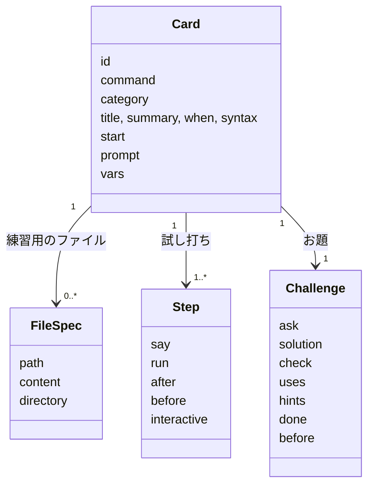
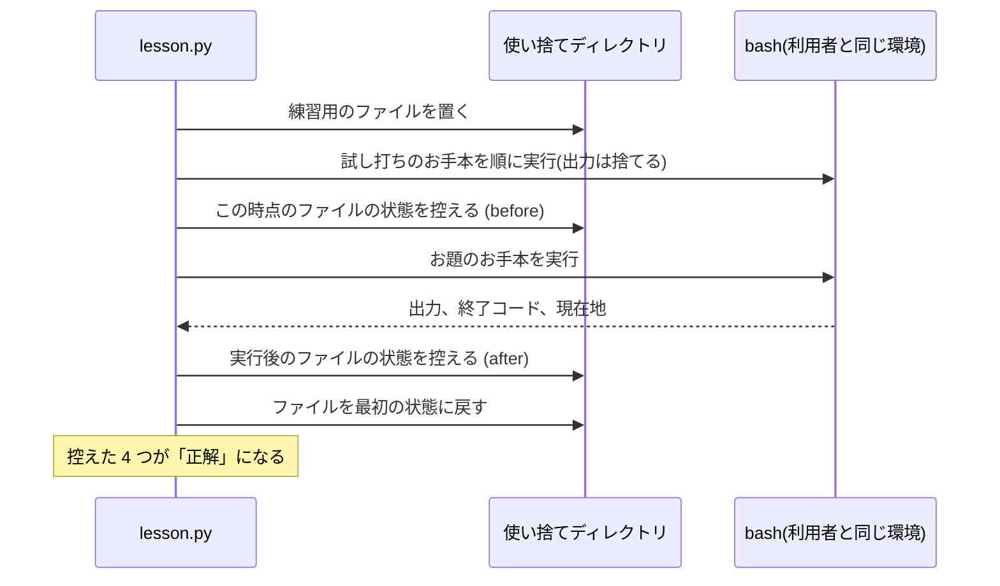
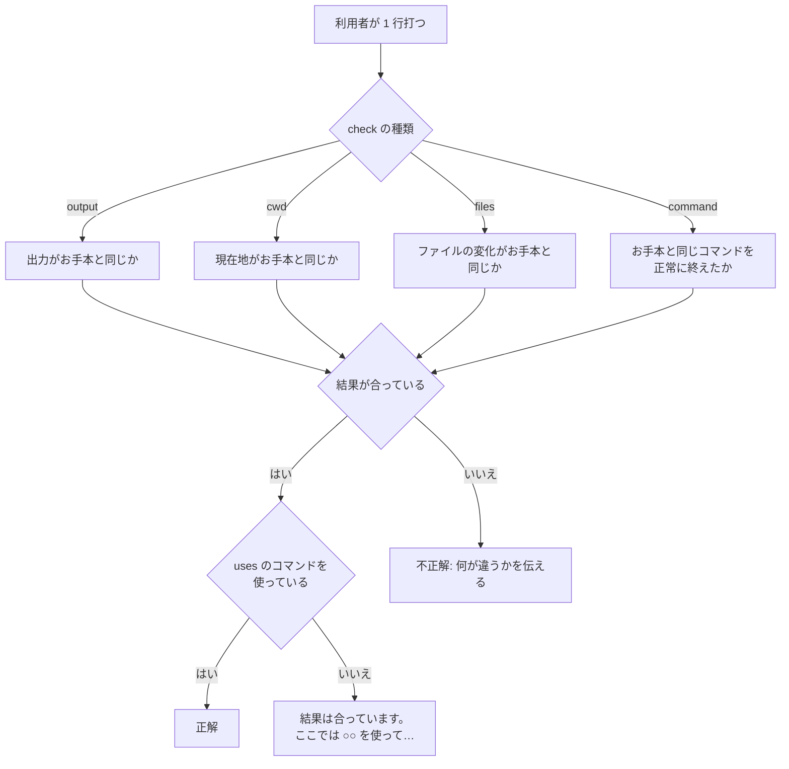

# コマンドと判定

コマンドの定義がどう読み込まれ、利用者の打ったコマンドがどう判定されるかを説明します。
定義の書き方そのものは、README の「コマンドの追加」にあります。

対応するコードは次のとおりです。

- `src/dayone/card.py`: コマンドの定義(`cards/*.toml`)の読み込み
- `src/dayone/lesson.py`: コマンド 1 つの練習の進行と判定
- `src/dayone/judge.py`: 判定の部品

## コマンドの構造

コマンド 1 つの定義は 1 つの TOML ファイルで、`card.py` が次のデータに読み込みます。



- `id` はファイル名から番号を除いた部分です(`02_ls.toml` → `ls`)。セーブデータはこの id で記録します。
- 一覧に並ぶ順番は、ファイル名の順です。

## 開くたびに中身を変える

定義の `[vars]` には、`{{名前}}` に入れる候補を並べます。

```toml
[vars]
place = ["documents/reports", "documents/letters", "projects/website"]

[challenge]
ask = "`{{place}}` へ移動してください。"
solution = "cd ~/{{place}}"
```

コマンドを開くたびに `Card.instantiate` が候補から 1 つを選び、文章・ファイル・お手本の `{{place}}` を置き換えます。
同じコマンドでも復習のたびにお題が変わるので、答えの丸暗記では通りません。

## 正解はお手本を実行して求める

定義には「正しい出力」を書きません。書くのは**お手本のコマンド**(`solution`)だけです。
正解は、コマンドを開いたときに、お手本を利用者と同じ環境で先に実行して求めます(`compute_reference`)。



この方法には 2 つの利点があります。

- 定義を書く人は、ファイル・問い・お手本を用意するだけで済みます。
- 出力が環境によって変わるコマンド(`ls -l` の日付など)でも、その場で実行した結果と比べるので合います。

復習では試し打ちを飛ばすので、試し打ちのお手本は実行せず、最初の状態からお題のお手本だけを実行します。

### キー操作で結果が決まるコマンド(vim)

正解を求めるときは、キーを打つ人がいません。`vim memo.txt` をそのまま実行すると、入力を待ったまま進まなくなります。
そこで、vim の定義では次の 2 つを行っています。

- 試し打ちに `interactive = true` を付ける。正解を求めるときに、この手は実行しません。
- お題のお手本は、画面を使わない書き方にする(`vim -es -i NONE -c '命令' -c wq ファイル`)。
  これは「vim に命令を渡して実行させ、保存して終了する」書き方で、キー操作をしたのと同じファイルができます。

利用者はふつうに `vim` を開いてキーで編集し、判定は「保存されたファイルがお手本と同じか」で行います(`check = "files"`)。

## 試し打ちの判定

試し打ちは、案内されたコマンドを打てば次へ進みます。条件は次の 2 つです(`_on_step`)。

- コマンドが成功した(終了コードが 0)。
- 打った行が、お手本と同じコマンド・引数で、お手本のオプションを含んでいる(`follows_example`)。

`follows_example` は、語の順序とオプションの追加を問いません。
お手本が `ls -l` なら、`ls -la` や `ls -l -a` でも進みます。引数が増えたり違ったりした場合は進みません。

それ以外のコマンドは「寄り道」として自由に試せます。お手本と違うコマンドが 2 回続くと、進み方をもう一度案内します。

## お題の判定

お題は、次の 2 つをどちらも満たすと正解です(`_on_challenge`)。

1. **結果が合っている**(何を比べるかは `check` で決まる)
2. **練習中のコマンドを使っている**(`uses`。既定では定義の `command`)



| check | 比べるもの | 補足 |
|---|---|---|
| `output`(既定) | 出力 | 色や列の並びの違いは無視する |
| `cwd` | 現在地 | 何手かに分けて移動してもよい |
| `files` | ファイルの変化 | 何手かに分けて達成してもよい |
| `command` | 打ったコマンド | `less` や `man` など、出力で比べられないコマンド用 |

2 つ目の条件があるのは、別の方法で同じ結果を出せてしまうからです。
たとえば `head` のお題と同じ出力は `sed` などでも出せますが、それでは `head` を覚えたことになりません。

### 出力の比べ方

`ls` は、端末では色付きの複数列で、パイプ越しでは 1 列で出力します。お手本の出力はファイルに保存して取るので、
利用者の画面の出力とは見た目が違います。

`judge.py` の `tokens` は、制御文字列(色など)を取り除き、空白で区切った語の並びにしてから比べます。
これで、見た目の違いを無視して中身だけを比べられます。

### 使ったコマンドの調べ方

`commands_in` は、打たれた行を `|`・`;`・`&&`・`$(` などで区切り、各部分の先頭の語をコマンド名として取り出します。

```
grep apple fruits.txt | wc -l      → {grep, wc}
cd docs && ls -l; /usr/bin/cat a   → {cd, ls, cat}
echo ls                            → {echo}
```

### ファイルの変化の比べ方

`snapshot` は、ディレクトリ以下の全ファイルについて「種類と中身の要約(SHA-256)」を記録します。
`compare_files` は、お手本の実行前(before)と実行後(after)の変化が、利用者のディレクトリにも起きているかを調べます。

| お手本での変化 | 確かめること | 違っていたときの案内 |
|---|---|---|
| 消えた | 利用者のほうでも消えている | 「○○ がまだ残っています。」 |
| 作られた・書き換えられた | 同じ種類・同じ中身で存在する | 「○○ がまだありません。」「中身がお題と違います。」 |
| 触らなかった | 残っている | 「○○ がなくなっています。…開き直すとやり直せます。」 |

余分なファイルを作っていても、不正解にはしません。

## ヒントと指摘の出し方

ヒントと、不正解のときの指摘(「出力が違うようです」など)は、表示の部分ではなく入力欄の下に出します。
次のコマンドを打っても流れないので、見ながら打てます(詳しくは [terminal.md](terminal.md))。

- ヒントは 1 回の `hint` で 1 つずつ開き、開いたものはその段階のあいだ出たままです。
- 指摘は、次のコマンドを打つと消えます。
- `card` と打つと、コマンドの説明をもう一度表示します。ヒントにも間違いにも数えません。
- `title` と打つと、練習をやめてトップページ(一覧)に戻ります。`exit` と打つと、アプリを終了します。
  どちらも正解していないので、記録は残りません。

## ヒントと間違いの数え方

練習を終えるとき、`Lesson.play` は次の結果を返します(`Outcome`)。

| 項目 | 数えるもの |
|---|---|
| `hints` | お題で開いたヒントの数(試し打ちでの `hint` は数えない) |
| `misses` | お題で、正解になるまでに打った正解でないコマンドの数(寄り道を含む) |
| `wrong` | そのうち、答えようとして間違えた数 |

「答えようとして間違えた」とみなすのは、結果は合っているのにコマンドが違う場合と、
練習中のコマンドを使ったのに結果が違う場合です。`pwd` で場所を確かめるような寄り道は、間違いに数えません。
`cd` のお題で、目的地へ向かう途中のディレクトリにいる場合も、間違いに数えません。

ヒントなし・間違いなしで解けたかどうか(`clean`)が、復習の間隔を決めます([progress.md](progress.md))。

## テストとの関係

お手本を実行して正解を求める仕組みなので、テストでも同じことができます。
`tests/test_cards.py` は、全コマンドについてお手本どおりに打ち込み、正解になることを確かめます。
定義の TOML を書き間違えると、このテストが落ちます。
