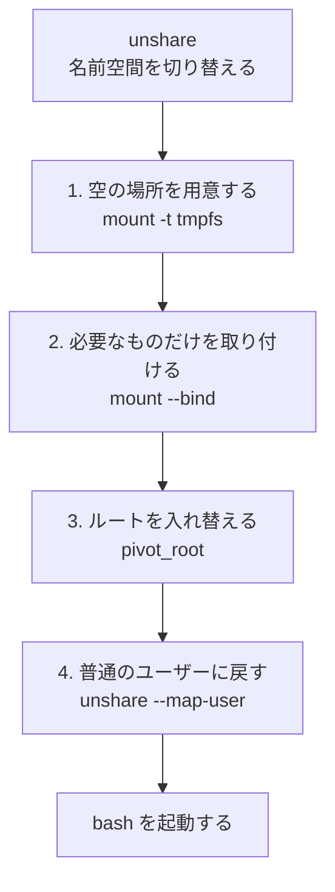

# 隔離モードの仕組み

day-one の練習で打ったコマンドは、本物の bash で実行されます。
それでも `rm` などで本来の環境が壊れないのは、bash を「隔離された部屋」の中で動かしているからです。
このドキュメントでは、その部屋がどう作られているかを説明します。

対応するコードは次の 2 つです。

- `src/dayone/sandbox.py`: 部屋を作るコマンドを組み立てる
- `src/dayone/shell/sandbox_init.sh`: 部屋の中身を用意して bash を起動する

## 考え方

危ない操作を見張って止めるのではなく、**壊せるものが最初から存在しない場所**を作ります。

```
本来の環境                          隔離された部屋
/                                   /
├── usr, etc                        ├── usr, etc      ← 本来のものをそのまま見せる
├── home/あなた  (大事なファイル)   ├── home/あなた   ← 中身は練習用のディレクトリ
├── mnt/c        (Windows 側)       ├── tmp           ← 部屋専用の空の場所
└── tmp/dayone-xxxx/home ─────────→ └── dev, proc
        (練習用のディレクトリ)
                                    本来のホームと /mnt は、どこにもない
```

部屋の中の `/home/あなた` の正体は、`/tmp/dayone-xxxx/home` という使い捨てのディレクトリです。
コマンドを開くたびに作られ、終えると消えます。

## 使っている Linux の機能

### 名前空間(namespace)

Linux には、プロセスごとに「見える世界」を切り替える機能があり、名前空間と呼びます。
見える世界の種類ごとに名前空間があり、day-one は次の 6 つを切り替えています。

| 名前空間 | 切り離されるもの | 部屋の中での結果 |
|---|---|---|
| マウント | ファイルシステムの見え方 | 用意したディレクトリしか見えない |
| PID | プロセスの一覧 | ほかのプロセスが見えず、`kill` もできない |
| ネットワーク | ネットワークの接続 | 外とつながらない |
| UTS | ホスト名 | ホスト名が `day-one` になる |
| IPC | プロセス間のやり取り | 外のプロセスとやり取りできない |
| ユーザー | ユーザーと権限 | 下の「ユーザー名前空間」を参照 |

名前空間を切り替えてコマンドを実行するのが `unshare` コマンドです。
day-one は次の形で呼び出しています(`sandbox.py` の `_UNSHARE`)。

```bash
unshare --user --map-root-user --mount --pid --fork --kill-child --uts --ipc --net \
    -- bash sandbox_init.sh  (部屋の中で動かすコマンド)
```

`--kill-child` は、アプリが終了したら部屋の中のプロセスもすべて終了させる指定です。

### ユーザー名前空間

ファイルシステムを組み替える操作(`mount` など)は、本来は管理者(root)にしかできません。
ユーザー名前空間を使うと、**その名前空間の中だけで通用する管理者権限**を、普通のユーザーが持てます。

- `--map-root-user`: 部屋の中では、自分を root として扱う
- 部屋の外から見れば、ずっと普通のユーザーのまま

つまり、部屋を作るための権限は手に入りますが、本物の root になるわけではありません。
部屋の外にある root のファイルを書き換えることはできません。

## 部屋を作る手順

`sandbox_init.sh` は、名前空間を切り替えた直後に実行され、次の順で部屋を作ります。



### 1. 空の場所を用意する

```bash
mount -t tmpfs -o mode=755 tmpfs "$root"
```

メモリ上に空のファイルシステム(tmpfs)を作ります。これが新しい `/` の候補です。
この時点では何も入っていません。

### 2. 必要なものだけを取り付ける

```bash
mount --rbind /usr "$root/usr"
mount --rbind /etc "$root/etc"
mount --rbind /dev "$root/dev"
mount -t proc proc "$root/proc"
mount --bind "$DAYONE_HOME_SRC" "$root/home/$DAYONE_USER"
```

`mount --bind` は、あるディレクトリを別の場所にも見せる操作です(コピーはしません)。

| 部屋の中の場所 | 中身 | 理由 |
|---|---|---|
| `/usr`、`/bin`、`/lib` など | 本来のもの | `ls` や `cat` などのコマンド本体がここにある |
| `/etc` | 本来のもの | コマンドが読む設定がここにある |
| `/dev`、`/proc` | 端末やプロセスの情報 | bash やコマンドが動くのに必要 |
| `/home/あなた` | 練習用のディレクトリ | コマンドのファイルを置く場所 |
| `/tmp` | 部屋専用の空の場所 | 一時ファイル用 |

`vim` や `less` のようなコマンドも `/usr` に入っているので、部屋の中でそのまま使えます。
`vim` が作る履歴のファイル(`~/.viminfo`)も練習用のディレクトリにできるので、本来のホームには残りません。

本来のホームと `/mnt` は取り付けません。取り付けていないものは、部屋の中に存在しません。

### 3. ルートを入れ替える

```bash
cd "$root"
pivot_root . old
umount -l /old
rmdir /old
```

`pivot_root` は、プロセスにとっての `/` を別のディレクトリに入れ替える操作です。

1. 用意した場所を新しい `/` にし、元の `/` を一時的に `/old` に置く
2. `/old` を取り外して消す

これで、元のファイルシステムへ戻る道がなくなります。`cd ..` を繰り返しても、たどり着くのは部屋の `/` です。

### 4. 普通のユーザーに戻して bash を起動する

```bash
exec unshare --user --map-user="$DAYONE_UID" --map-group="$DAYONE_GID" -- "$@"
```

部屋を作り終えたら、管理者権限は不要です。もう 1 段ユーザー名前空間を重ねて、元のユーザーに戻します。
bash の中で `whoami` を打つと、root ではなくあなたのユーザー名が出ます。

あわせて、環境変数も本来のものは引き継がず、必要なものだけを渡します(`sandbox.py` の `shell_command`)。

## 自分で確かめる

練習の途中では好きなコマンドを試せます。次のように打つと、部屋の様子が分かります。

| 打つコマンド | 分かること |
|---|---|
| `ls /` | `/` にあるのは、取り付けたものだけ |
| `ls /home` | あるのは自分のディレクトリだけ |
| `ls /mnt` | Windows 側は存在しない(エラーになる) |
| `ps aux` | 見えるプロセスは、部屋の中の数個だけ |
| `hostname` | `day-one` と出る |
| `whoami` | 自分のユーザー名が出る(root ではない) |

`dayone --mode guard`(簡易モード)で同じコマンドを打つと、本来の環境がそのまま見えるので、違いが分かります。

## できないこと・注意点

- **`/usr` と `/etc` は本物です。** コピーではないので、部屋の中から読めます。
  書き換えられないのは、root のファイルを書き換える権限が部屋の中にもないからです。
- **仮想マシンではありません。** Linux のカーネルは本来の環境と共有しています。
  うっかりミスや練習中の事故を防ぐには十分ですが、悪意のあるプログラムを閉じ込める用途は想定していません。
- **使えない環境があります。** 名前空間の作成が禁止されている環境(一部のコンテナの中など)では部屋を作れません。
  その場合は、起動時に実際に作れるかを試したうえで(`isolation_available`)、簡易モードに切り替わります。

## コンテナとの関係

Docker などのコンテナも、同じ名前空間と `pivot_root` を使っています。
day-one の隔離モードは、「イメージを使わず、いまの Ubuntu の `/usr` と `/etc` をそのまま借りる、小さなコンテナ」と考えると近いです。
