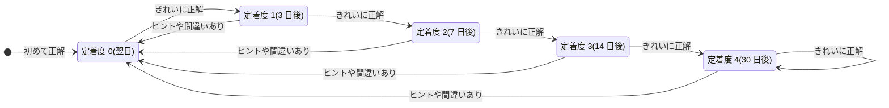
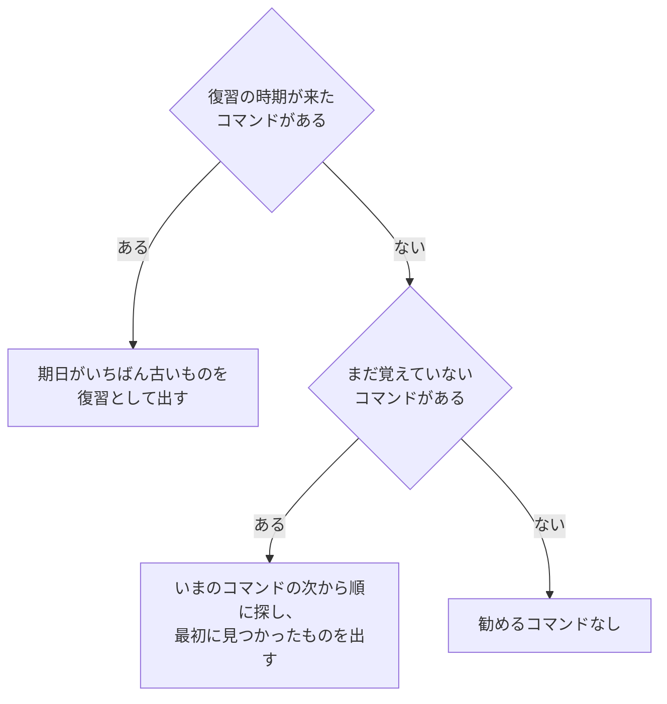

# 進捗と復習

どのコマンドを覚えたかの記録と、復習の時期の決め方を説明します。

対応するコードは次のとおりです。

- `src/dayone/progress.py`: 進捗の保存と、復習の時期の管理
- `src/dayone/cli.py` の `_recommend`: 次に勧めるコマンドの選び方

## 復習の間隔

覚えたことは、忘れかけた頃に思い出すと定着しやすくなります(間隔反復)。
day-one は、コマンドごとに**定着度**(0〜4)を持ち、定着度が上がるほど次の復習までの間隔を空けます。

| 定着度 | 正解したときの表示 | 次の復習まで |
|---|---|---|
| 0 | ●○○○○ | 1 日 |
| 1 | ●●○○○ | 3 日 |
| 2 | ●●●○○ | 7 日 |
| 3 | ●●●●○ | 14 日 |
| 4 | ●●●●● | 30 日 |

一覧には定着度を出さず、コマンドごとに印だけを出します(`cli.py` の `_mark`)。

| 印 | 画面での呼び名 | 条件 |
|---|---|---|
| (なし) | — | セーブデータにそのコマンドの記録がない(まだ正解していない) |
| ✓ | おぼえた | 記録があり、次に復習する日(`due`)がまだ来ていない |
| ! | 復習どき | 記録があり、次に復習する日が今日か、それより前 |

「復習どき」のコマンドは、復習して正解するまで `!` のままです。正解すると次に復習する日が先へ延び、`✓` に戻ります。

定着度は、復習の結果で次のように変わります(`Progress.record`)。



- **初めて正解したとき**は、ヒントや間違いの有無にかかわらず定着度 0 から始まり、翌日に復習になります。
- **きれいに正解**(ヒントなし・間違いなし)すると、定着度が 1 つ上がります。
- **ヒントを使ったり間違えたりした**ときは、定着度が 0 に戻り、翌日また出題されます。
- 途中でやめたコマンド(`title` でトップページに戻った場合)は記録しません。

「間違い」の数え方は [cards.md](cards.md) にあります。寄り道のコマンドは間違いに数えません。

## 次に勧めるコマンド

一覧や練習を終えたあとに Enter で始まるコマンドは、次の順で決まります(`_recommend`)。



- **復習**として開いたコマンドは、説明と試し打ちを飛ばし、中身を変えたお題だけを出します。
- 一覧でコマンドを打って**自分で選んだ**コマンドは、覚えたものでも説明から通して開きます。

## セーブデータ

保存先は `~/.local/share/dayone/progress.json` です。
環境変数 `DAYONE_DATA_DIR` があればそのディレクトリを、なければ `XDG_DATA_HOME` の下の `dayone/` を使います。

```json
{
  "version": 1,
  "tutorial_seen": true,
  "cards": {
    "pwd": {
      "learned": "2026-10-11",
      "level": 1,
      "due": "2026-10-15",
      "reviews": 1
    }
  }
}
```

| 項目 | 内容 |
|---|---|
| `version` | セーブデータの形式の番号 |
| `tutorial_seen` | チュートリアルを見せたか。初めて起動したときに `true` になり、以後は自動では出さない(項目がない古いデータは、まだ見せていないものとして扱う) |
| `cards` のキー | コマンドの id(`cards/02_ls.toml` なら `ls`) |
| `learned` | 初めて正解した日 |
| `level` | 定着度(0〜4) |
| `due` | 次に復習する日 |
| `reviews` | 覚えたあとに正解した回数 |

記録するのは正解したコマンドだけです。キーがないコマンドは「まだ覚えていない」として扱います。

## データを壊さない工夫

- **書き込みの途中で落ちても壊れない**: 別のファイル(`progress.json.tmp`)に書き終えてから、
  本来のファイルと置き換えます(`os.replace`)。置き換えは一瞬で終わるので、中途半端な状態が残りません。
- **読めないデータを消さない**: セーブデータが壊れていたり、形式の番号が違ったりして読めないときは、
  `progress.json.broken-(時刻)` という名前で残したうえで新しく始め、起動時にその旨を知らせます。
- **消す前に確認する**: `dayone --reset-progress` は、消す前に `y` の入力を求めます。

## 動作確認のしかた

復習は日付で決まるので、そのままでは翌日まで確かめられません。
環境変数 `DAYONE_TODAY` で今日の日付を差し替えると、すぐに確かめられます。

```bash
DAYONE_DATA_DIR=/tmp/dayone-test dayone                         # 本来のセーブデータに触れずに試す
DAYONE_DATA_DIR=/tmp/dayone-test DAYONE_TODAY=2026-10-20 dayone # 日付を進めて復習を出す
```
