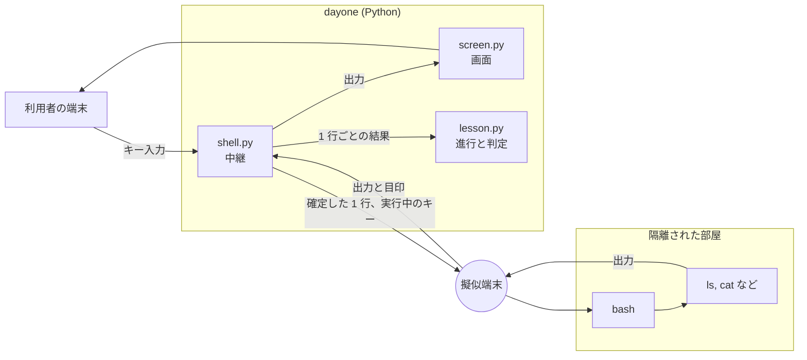
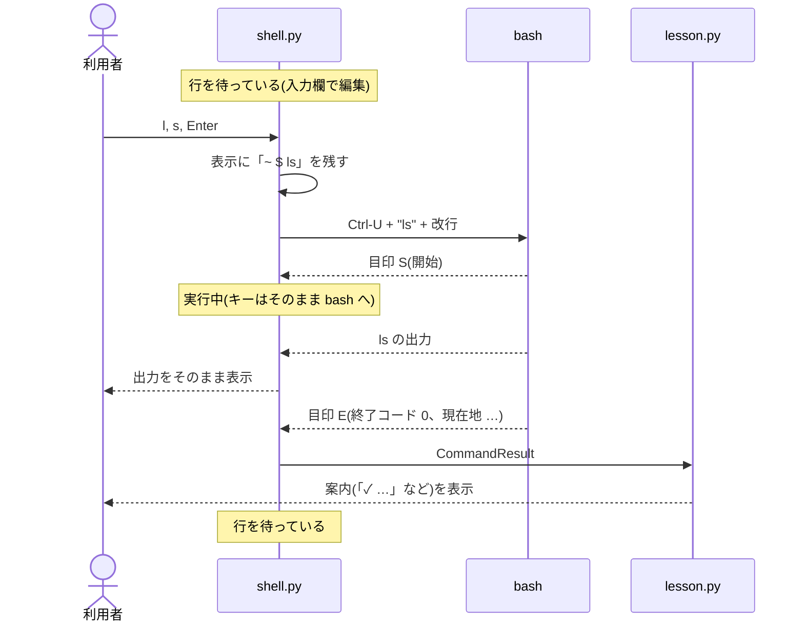
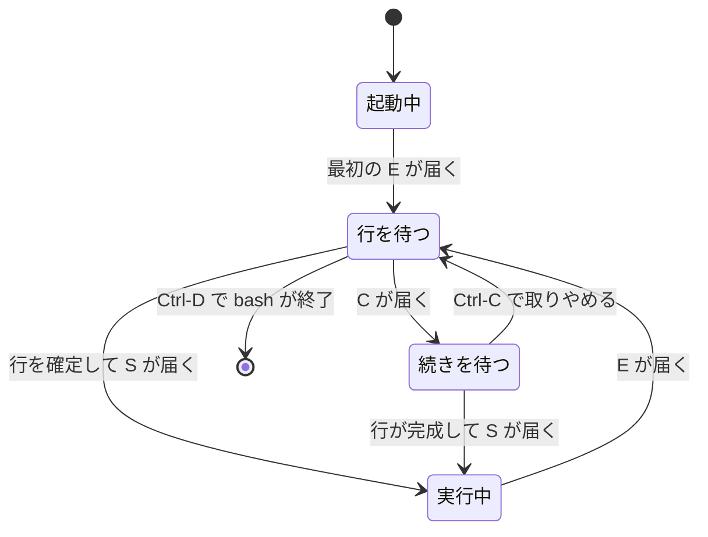

# bash との中継

練習で打ったコマンドは本物の bash が実行します。
アプリはその入出力を中継しながら、「どの行が打たれ、何が出力され、どう終わったか」を 1 行ごとに受け取ります。
このドキュメントでは、その仕組みを説明します。

対応するコードは次のとおりです。

- `src/dayone/shell.py`: 擬似端末の作成、入出力の中継、目印の読み取り
- `src/dayone/shell/bashrc`: 練習用 bash の設定(目印を出す側)
- `src/dayone/sandbox.py`: bash の起動コマンドの組み立て

## 全体の形



## 擬似端末(PTY)

`ls` が色を付けて複数列で表示するのも、`less` が画面いっぱいに開くのも、相手が端末だと分かっているからです。
出力先がパイプだと、これらのコマンドは色も列も付けない別の動きをします。

そこで、アプリは擬似端末を作り、bash にはそれを本物の端末だと思わせます。

- `pty.openpty()` で、対になった 2 つの口(マスターとスレーブ)を作ります。
- bash の標準入力・標準出力・標準エラーをスレーブにつなぎます。
- アプリはマスター側を読み書きします。マスターに書いたものは bash のキー入力になり、bash の出力はマスターから読めます。
- 擬似端末を bash の制御端末にします(`TIOCSCTTY`)。これで Ctrl-C やジョブ制御が効きます。
- 擬似端末の大きさは、画面のうち「表示」の部分の大きさにします(`_sync_window_size`)。
  `less` や `vim` などは、この大きさに合わせて描画します。

## bash の起動

`sandbox.py` の `shell_command` が、次の形のコマンドを組み立てます。

```bash
bash --noediting --rcfile (bashrc の場所) -i
```

| 指定 | 理由 |
|---|---|
| `-i` | 対話シェルとして動かす(プロンプトを出し、履歴を持つ) |
| `--rcfile` | 利用者の `~/.bashrc` ではなく、練習用の設定を読ませる |
| `--noediting` | bash 自身の行編集(readline)を使わない。行の編集はアプリの入力欄で行う |

環境変数は本来のものを引き継がず、`HOME`・`PATH`・`TERM` など必要なものだけを渡します。
隔離モードでは、このコマンドの前に `unshare …` が付きます([isolation.md](isolation.md))。

## 目印で 1 行ごとの結果を知る

bash の出力は、ただの文字の流れです。そのままでは、どこからどこまでが 1 つのコマンドの出力なのか、
コマンドが成功したのかが分かりません。

そこで、bash に**目印**を出力させます。目印は端末には表示されない制御文字列(OSC)で、次の形をしています。

```
ESC ] 7770 ; 内容 BEL
```

目印は 3 種類あり、`bashrc` で bash の機能に仕込んであります。

| 目印 | 出すタイミング | bash の機能 | 内容 |
|---|---|---|---|
| 開始 `S` | 打たれた行を実行する直前 | `PS0` | なし |
| 終了 `E` | 実行が終わり、次の行を待つ直前 | `PROMPT_COMMAND` | 終了コード、現在地、打たれた行、入力欄に出す現在地 |
| 続き `C` | 引用符が閉じていないなど、行の続きを待つとき | `PS2` | なし |

終了の目印に添える値は、区切り文字と衝突しないよう base64 にしています。打たれた行は `history 1` から取ります。

`shell.py` の `_MarkerParser` が、マスターから読んだバイト列を「画面に出す部分」と「目印」に分けます。
目印が読み込みの切れ目をまたいで届いても、正しく取り出せるようにしてあります。

- 画面に出す部分は、そのまま端末へ流します。開始から終了までの分は、判定用にも溜めます。
- 終了の目印を読んだら、溜めた出力と合わせて `CommandResult`(打った行、終了コード、現在地、出力)を作り、
  `lesson.py` に渡します。

## コマンド 1 つの流れ



## キー入力の行き先

`Shell` は、bash がいまどの状態にあるかを目印から把握し、キー入力の行き先を切り替えます。



| 状態 | キー入力の行き先 |
|---|---|
| 起動中 | 捨てる |
| 行を待つ・続きを待つ | アプリの入力欄(`lineedit.py`)。Enter で確定した 1 行だけを bash に渡す |
| 実行中 | そのまま bash へ。`less` や `vim` の操作、`cat` への入力、Ctrl-C がそのまま届く |

入力を待つループは `select` で、bash の出力・キー入力・端末の大きさの変化の 3 つを同時に待ちます(`Shell.run`)。

## エコーの切り替え

端末には、打った文字をそのまま表示する「エコー」という機能があります。

- 行を待つあいだは、打った文字はアプリの入力欄に出ています。エコーがあると二重に表示されるので、切ります。
- 実行中は、`cat` のように入力を読むコマンドのために、エコーを戻します。

この切り替えも `bashrc` で行っています。

```bash
PS0='$(stty echo 2>/dev/null)'…      # 実行の直前にエコーを戻す
__dayone_report() { …; stty -echo; … }   # 次の行を待つ前にエコーを切る
```

bash 自身のプロンプト(`PS1`)は空にしてあります。プロンプトは、アプリが入力欄に描きます。

## 画面に出さずにコマンドを実行する

`Shell.run_hidden` は、利用者に見せずに bash でコマンドを実行し、その出力を返します。次の 2 つに使います。

- **場面転換**: コマンドが「あなたを別のディレクトリへ移動させました」と言う前に、実際に `cd` しておく(定義の `before`)。
- **Tab 補完**: 候補を bash に尋ねる(`compgen`)。

実行したコマンドは `history -d -1` で履歴から消すので、↑ キーでは出てきません。

## アプリが反応する合言葉

`hint`・`card`・`title` は、bash の中では何もしない関数として定義してあります(`bashrc`)。
bash にとっては「成功した空のコマンド」ですが、`lesson.py` は打たれた行を見て、ヒントを開いたり、コマンドの説明を出し直したり、
練習をやめてトップページ(一覧)に戻ったりします。

合言葉は、Linux のコマンドと重ならない名前にします。同じ名前の関数を定義すると、bash は関数のほうを先に使うので、
本来のコマンドが練習の中で実行できなくなるためです(一時 `top` を使っていましたが、プロセスを一覧するコマンドと重なるのでやめました)。

`exit` も、同じ名前の関数で受け止めます。アプリを終了できるのはトップページだけなので、練習の中では bash を閉じずに
「exit はトップページで使えます。…」と案内を出します(スクリプトや `( )` の中の `exit` は、ふつうに働きます)。
空の行で Ctrl-D を押すと bash が終了し(`Shell.run` が False を返す)、アプリはトップページに戻ります。

## 細かい工夫

- **打ちかけの文字を消す**: 実行中に打たれて bash 側に残った文字があると、次の行の先頭に混ざります。
  行を渡すときは先頭に Ctrl-U(行の取り消し)を付けて、これを消します。
- **起動時の出力を見せない**: 最初の終了の目印が届くまでの出力は、画面に出しません。
- **`command not found` の案内を止める**: Ubuntu は打ち間違いに「`sudo apt install …`」と案内しますが、
  ここでは混乱のもとなので、`command_not_found_handle` を外しています。
- **後始末**: 練習を終えるときは bash を止め、そのコマンドから起動されたプロセスが残っていれば止めます。
  プロセスは、環境変数 `DAYONE_SESSION` に入れた合言葉で見分けます(`procs.py`)。
