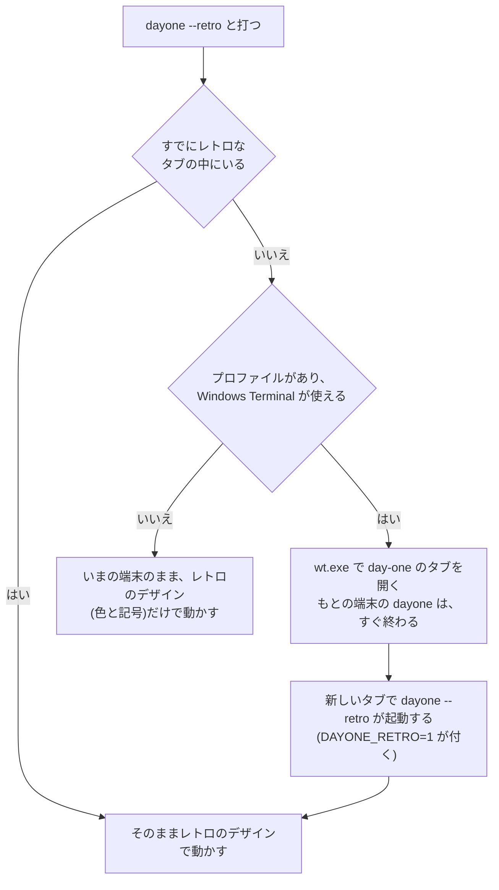
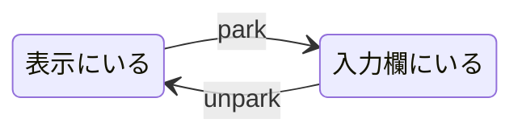
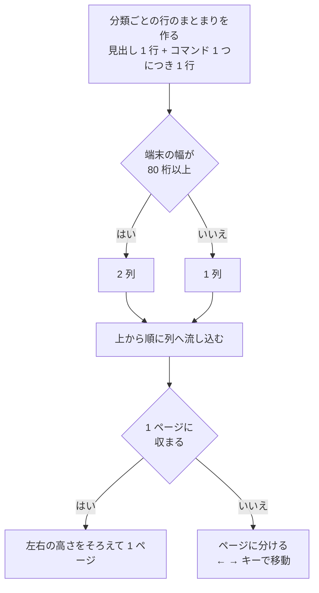
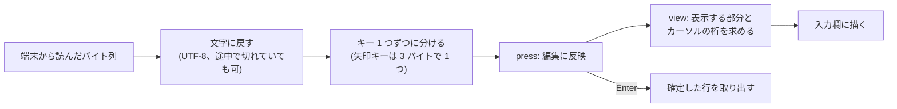
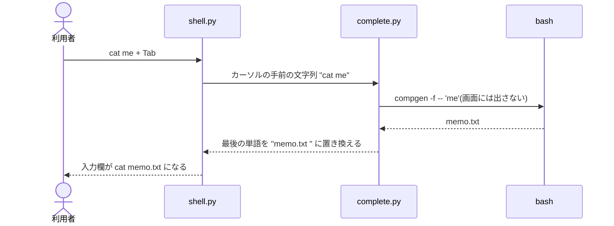

# 画面と入力

day-one は、端末を「表示」「入力欄」「ステータスバー」の 3 つに分けて使います。
このドキュメントでは、その描き方と、入力欄・Tab 補完の仕組みを説明します。

対応するコードは次のとおりです。

- `src/dayone/screen.py`: 画面の割り付けと描画
- `src/dayone/lineedit.py`: 入力欄の行編集
- `src/dayone/complete.py`: Tab 補完
- `src/dayone/prose.py`: 日本語の文章の折り返し
- `src/dayone/design.py`、`src/dayone/designs/`: 画面のデザイン(通常とレトロ)

## 画面の割り付け

```
 1 ┐
 2 │  表示(スクロール範囲)
 … │  コマンドの説明、打ったコマンドとその結果、案内が流れる
 R ┘
R+1  ─ ls ─────────── hint ヒント │ card 説明 │ title トップページに戻る ─   罫線(左端にコマンド、右端に操作)
R+2  ~ $ ls -l                                                     入力欄
R+3  ──────────────────────────────────────────────────────────   罫線
R+4  ▶ 打ってみよう 2/3  ●●○☆                                      ステータスバー
 …     名前だけでなく詳しい情報も見られます。…                     (お題、開いたヒント、直前の指摘。
       ヒント ls -l と打ってみましょう。                                 なければ 0 行)
```

表示の行数 R は、端末の行数から下の部分(罫線 2 行、入力欄 1 行、お題の行数)を引いたものです。
お題が長くても、表示には最低 5 行を残します。

下の部分に出す内容は、進行の側(`cli.py`、`lesson.py`)が次の 2 つで差し替えます。

| 操作 | 出る場所 | 内容 |
|---|---|---|
| `Screen.set_status` | 入力欄の上の罫線。左端に `title`、右端に操作 | 練習の途中: 左端に開いているコマンド(復習なら「ls 復習」)、右端に `hint`、`card`、`title`。一覧: 右端に Enter で開くコマンド、← → でのページ送り(ページがあるときだけ)、`exit` での終了。練習を終えたあと: 何も出さない |
| `Screen.set_task` | ステータスバー | 練習の途中: お題、進み具合、開いたヒント、直前の指摘。練習を終えたあと: 次の一手(Enter で次のコマンド、`r` もう一度、`title` トップページに戻る) |
| `Screen.read_line` の `placeholder` | 入力欄(入力を待っていて、何も打たれていないあいだ) | 一覧: 「Enter / コマンドを入力(例: cd)」。薄い文字で出し、1 文字打つと消える |
| `Screen.set_idle` | 入力欄(入力を待っていないあいだ) | `less` や `vim` を開いているときの閉じ方 |

ステータスバーの中身は `lesson.py` の `_task_text` が組み立てます。

- **進み具合**: 見出しの `●●○☆` は、試し打ちの 1 手が ●、お題が ★ です(`_track`)。
- **段階が進んだ合図**: 段階が進むと、次のコマンドを打つまで見出しを目立たせ(通常のデザインでは反転、レトロでは明るい文字)、「次へ進みました」と添えます。
- **ヒント**: `hint` で開いたヒントは、その段階のあいだ出したままにします。
- **直前の指摘**: 「出力が違うようです」などは、次のコマンドを打つまで出します。

これらを表示の部分に流さないのは、次のコマンドを打つと上へ消えてしまい、見ながら打てないからです。
表示の部分に流れるのは、打ったコマンド、その結果、「✓ …」の一言、`card` で出し直した説明です。

`less`・`man`・`vim` などを開くと、入力欄には閉じ方が出ます(`shell.py` の `_HOW_TO_CLOSE`)。
閉じ方が分からず出られなくなるのを防ぐためです。

幅に収まらないときは、罫線の上の内容は末尾を「…」で切り、お題は幅に合わせて折り返します。
実行方式(隔離モードか簡易モードか)は、この罫線には出しません。出すのは一覧のロゴの下だけです。

## デザイン

画面のデザインは 2 つあり、それぞれ独立したファイルに入っています。

| デザイン | ファイル | 使われるとき |
|---|---|---|
| 通常 | `src/dayone/designs/normal.py` | `dayone` で動かすとき(いまの端末のまま) |
| レトロ | `src/dayone/designs/retro.py` | `dayone --retro` で動かすとき(専用のタブの中) |

`dayone --design normal` / `--design retro` で、どちらを使うかを指定することもできます。

2 つのファイルは、互いに何も共有していません。どちらも同じ名前の項目をすべて自分で定義しているので、
片方を変えても、もう片方の見た目は変わりません(共通の定義を読み込んでいないことは、`tests/test_design.py` が確かめます)。

| 項目 | 内容 | 通常 | レトロ |
|---|---|---|---|
| `STYLES` | 役割ごとの色と飾り(`d.command`、`d.heading` など) | 役割ごとに色相を変える | 緑の濃淡(明るさ)と太字で示す。背景に色は付けず、下線も引かない。ヒントは琥珀色、復習は赤みのある橙 |
| 記号(`CHECK`、`ONCALL`、`BAR_ON` など) | 印、進み具合、見出しの先頭 | `✓` `◆` `■□` `●○★☆` `▶` | ASCII だけ(`*` `+` `#-` `@.` `>>`) |
| `BOX`、`RULE`、`SEPARATOR` | 枠と線の形 | 角の丸い罫線、`─`、`│` | `+--+` の枠、`=`、`|` |
| `TAGLINE`、`SHOW_MODE` | ロゴの下に出す行(ひとことの説明、「隔離モードで実行中」) | 両方出す | どちらも出さない(ロゴのすぐ下に一覧を置く) |
| `SHOW_TRACK`、`ADVANCED_NOTE` | 練習の見出しの右に添える、進み具合の印と「次へ進みました」 | 両方出す | どちらも出さない(見出しは「>> 打ってみよう 2/3」まで) |
| `LOGO` | トップページのロゴ | 小文字の day-one | `#` で描いた大文字の DAY-ONE(`\` を使わない。日本語のフォントでは `\` が円記号で表示されるため) |
| `CURSOR` | 入力欄のカーソルの形 | 点滅する縦棒 | 指定しない(端末の設定に任せる) |
| `TERMINAL` | 端末の側の設定 | なし(いまの端末のまま) | フォント、配色、走査線、カーソルの高さ |

画面を描くコードは、色を名前(`[d.command]ls[/]`)で、記号を `design.active.CHECK` のように書きます。
具体的な色や文字は書きません。`design.py` が、いまどちらのデザインを使うかを決めます。

レトロのデザインが記号を ASCII だけにしているのは、昔の端末らしく見せるためと、フォントによって記号の幅が
ずれるのを避けるためです。

### 通常のデザインの配色

通常のデザインでは、色を種類ごとに決めてあり、どの画面でも同じ意味で使います。同じ種類のものは同じ色、
種類が違うものは別の色にして、ぱっと見で役割が分かるようにしています。

| 色 | 意味 | トップページ | 練習の画面 |
|---|---|---|---|
| 水色(太字) | 打つもの | コマンドの名前、ロゴ | 説明の枠と入力欄の上の線に出るコマンド名、文章の中の `コード` |
| 紫(太字) | 見出し | 分類(「場所と移動」など) | 「▶ 打ってみよう」「▶ お題」「▶ 次へ」 |
| 白(太字) | 枠の見出し、いまいる位置 | 「コマンド一覧」「ページ 1/4」 | 説明の枠の見出しの文、進み具合のいまの手(`●` や `★`) |
| 緑 | できたこと | `✓` の印、バーの塗った部分、「隔離モード」 | 済んだ手の `●`、「✓ …」の一言、「正解!」「次へ進みました」 |
| 青(太字) | oncall に必要なもの | `◆` の印(コマンドの左と、「oncall への準備」の行) | — |
| 赤(太字) | 復習に関するもの | `!` の印、「今日の復習 1 個」 | 「復習」の表示 |
| 黄 | ヒントと指摘 | 「簡易モード」 | 「ヒント 1/2」、直前の指摘(`→` の行) |
| 薄い色 | 枠の線と補足 | 枠の線、番号、バーの残り | 枠の線、「説明」「いつ使う」「syntax」の見出し、これからの手(`○☆`) |

- 水色を「打つもの」だけに使うので、枠の線や見出しは水色にしません。画面の中で、打てばよい言葉だけが水色で浮きます。
- 枠の線は薄い色です。枠そのものより、中身を目立たせます。
- 「打ってみよう」と「お題」は、どちらも見出しなので同じ紫です。どちらの段階かは、見出しの文字と進み具合(`●●○☆` と `●●●★`)で分かります。

### 端末の側で決まるもの

フォント、色味、ブラウン管風の効果、カーソルの細かな太さは、アプリではなく端末(Windows Terminal)の設定で決まります。
アプリが出しているのは「水色で」「太字で」という指定だけで、その水色が実際にどんな色になるかは、端末の配色が決めます。

`dayone --retro-install` は、Windows Terminal に「day-one」というプロファイルを 1 つ足します(`retro.py` の `update_profile`)。
プロファイルの中身は、レトロのデザイン(`designs/retro.py`)の `TERMINAL` に書いてあるものです。

| 設定 | 内容 |
|---|---|
| 配色 `day-one retro` | 緑のブラウン管を思わせる色味。役割ごとの色相の違い(水色・紫・緑・赤・黄)は残してある |
| フォント | MS Gothic |
| `experimental.retroTerminalEffect` | 走査線と、文字のにじみ |
| カーソル | `vintage`(下から塗る四角。高さは文字の 80%)。レトロのデザインは、アプリからカーソルの形を指定しない |
| 起動するもの | WSL の `dayone`(`DAYONE_RETRO=1` を付ける) |

ほかのプロファイルは変えません。書き換える前の設定は、同じ場所に `settings.json.before-day-one` として残します。
`dayone --retro-remove` で、足したプロファイルと配色を取り除きます。

レトロなデザインで動かすには、`dayone --retro` と打ちます。`dayone` だけなら、いまの端末で通常のデザインのまま動きます。



- 動いている端末のフォントや配色を、アプリの側から変えることはできません。そこで、見た目を設定したプロファイルで
  新しいタブを開き、そちらでアプリを動かします(`retro.py` の `can_open_tab` と `open_tab`)。
- 新しいタブの中の `dayone` には、環境変数 `DAYONE_RETRO=1` が付きます。これがあれば、もう一度タブを開き直しません。
- プロファイルを足していない環境や、Windows Terminal のない環境では、タブを開けません。その場合は知らせを出したうえで、
  いまの端末のまま、レトロのデザインの色と記号だけで動かします。
- `dayone --design retro` は、タブを開かずに、いまの端末でレトロのデザインを描く指定です(動作確認用)。

## スクロール範囲を絞る

端末には、スクロールする範囲を一部の行に限る機能があります(DECSTBM)。
`ESC [ 1 ; R r` と書くと、1 行目から R 行目だけがスクロールするようになり、それより下の行は動かなくなります。

day-one はこれを使って、表示の部分だけを流し、入力欄とステータスバーを固定しています。

この方法の利点は、表示の部分が**普通の端末と同じように振る舞う**ことです。

- Rich の `console.print` も、bash の出力も、何も加工せずそのまま書けます。
- 最下行で改行すれば、範囲の中だけが 1 行上へ流れます。
- `less` や `vim` のような画面全体を使うコマンドも、範囲の大きさを端末の大きさだと思って動きます。
  これらを開いているあいだも、入力欄の下のお題は出たままです。

使っている制御文字列は次のとおりです。

| 文字列 | 名前 | 働き |
|---|---|---|
| `ESC [ 上 ; 下 r` | DECSTBM | スクロール範囲を設定する |
| `ESC 7` / `ESC 8` | DECSC / DECRC | カーソルの位置を覚える / 戻す |
| `ESC [ 行 ; 桁 H` | CUP | カーソルを指定の位置へ移す |
| `ESC [ K` | EL | カーソルから行末までを消す |
| `ESC [ J` | ED | カーソルから画面の終わりまでを消す |
| `ESC D` | IND | 1 行下へ進む(範囲の最下行なら 1 行流す) |
| `ESC [ 5 SP q` / `ESC [ 0 SP q` | DECSCUSR | カーソルの形を点滅する縦棒にする / 端末の設定に戻す |

## カーソルは 1 つしかない

表示に文字を書くにはカーソルが表示の部分に、入力を待つあいだはカーソルが入力欄に、それぞれ必要です。
しかし端末のカーソルは 1 つです。そこで、次の 2 つの操作で行き来させています。



- **park**: 表示でのカーソルの位置を覚え(`ESC 7`)、入力欄にプロンプトと編集中の行を描いて、カーソルをそこへ置く。
- **unpark**: 入力欄を空にして、覚えておいた位置へ戻す(`ESC 8`)。

カーソルの形は、デザインが決めます(`CURSOR`)。通常のデザインでは、起動時に点滅する縦棒に切り替え、
終了時に端末のもとの設定に戻します。レトロのデザインでは形を指定せず、端末の設定(文字の 80% の高さ)に任せます。

入力を待つ直前に park し、表示に何かを書く前に必ず unpark します(`Screen.write`・`echo`・`show`)。
この規則を守ることで、ほかのコードはカーソルの位置を意識せずに表示へ書けます。

## 崩れたら描き直す

bash の出力には、下の部分を壊すものがあります。

| 出力 | 例 | 起きること |
|---|---|---|
| 画面を消す | `clear` | 入力欄とステータスバーも消える |
| 別画面へ切り替える | `less`、`man`、`vim` | 切り替わった先の画面には何も描かれていない |
| スクロール範囲を変える | 画面を使うコマンド | 表示の部分だけを流す設定が外れる |

`Screen.write` は、中継する出力の中にこれらの制御文字列を見つけたら、
出力を書いたあとでスクロール範囲を設定し直し、下の部分を描き直します(`_DAMAGE` と `_layout`)。

## 大きさが変わるとき

表示の行数が変わる場面は 2 つあります。どちらも `Screen._reflow` が処理します。

- **端末の大きさが変わった**: 古い位置に残った罫線などを消し、新しい大きさで描き直します。
- **お題が変わった**: お題の行数が増えると表示が狭くなります。カーソルが隠れる行にあるときだけ、
  その分の中身を上へ流します。行数が減ったときは、空いた行を消します。

表示の行数が変わったら、bash 側の擬似端末の大きさも合わせます(`on_resize`)。

入力欄や下の部分は、上の仕組みでその場で割り付け直されます。一方、表示の部分にすでに描いた内容(一覧やチュートリアルの枠)は、
前の大きさに合わせて描いてあるので、そのままでは幅や行数が合いません。そこで、一覧とチュートリアルを出しているあいだに
大きさが変わったら、`Screen.read_line` が `RESIZED` を返し、呼び出し側が同じ画面を新しい大きさで描き直します
(2 列にするか、何ページに分けるかも、このとき決め直します)。練習の途中は、すでに流れた結果を描き直すことはせず、
入力欄・お題・bash 側の端末の大きさだけを合わせます。

端末の大きさの変化は、シグナル(SIGWINCH)で届きます。シグナルの処理の中で画面へ書くと、
書き込みの途中に割り込んで出力が壊れることがあります。そこで、シグナルが届いたことだけをパイプ経由で
入力待ちのループに知らせ、描き直しはループの側で行います(`signal.set_wakeup_fd`)。

## 場面が変わるとき

一覧からコマンドへ、コマンドから次のコマンドへ、コマンドから一覧へ、と場面が変わるときは、
表示の部分を消して先頭から書き始めます(`Screen.clear`)。前の場面の表示が残らないので、いま見るべき内容だけになります。

消すのは見えている画面だけです。端末を上にスクロールして見られる過去の内容は消しません。
練習の中で「打ってみよう」から「お題」へ進むときは、直前の結果が見えていたほうがよいので消しません。

## 一覧のページ分け

一覧(`cli.py` の `_show_menu`)は、表示の部分に収まるように並べます。コマンドが増えても、流れて見えなくなることはありません。

```
(ロゴ)
  コマンドを 1 つずつ。読んで、打って、使ってみる。
  隔離モードで実行中

╭─ コマンド一覧 ────────────────────────────────────────────────────────────────────────╮
│   場所と移動  ■■□  2/3                     中身を見る  □□□□  0/4                      │
│     1 ✓ ◆ pwd   いまいる場所を表示する       4   ◆ cat   ファイルの中身を表示する     │
│     2 ! ◆ ls    ファイルの一覧を表示する     5   ◆ head  ファイルの先頭だけを表示する │
│     3   ◆ cd    別のディレクトリへ移動する   6   ◆ tail  ファイルの末尾だけを表示する │
│                                                                                       │
│                                 ページ 1/4                                            │
│                                 ← → で移動                                            │
╰───────────────────────────────────────────────────────────────────────────────────────╯
  おぼえたコマンド   5%  ━━━━━━━━━━━━━━━━━━━━  2/38   今日の復習 1 個
◆ oncall への準備    6%  ━━━━━━━━━━━━━━━━━━━━  2/29

  ✓ おぼえた  ! 復習どき  ◆ oncall で使う
```

ページを送ると変わる部分(コマンドの一覧とページの案内)は、枠で囲みます。枠の左上には「コマンド一覧」という見出しを出します。枠の外(ロゴ、進み具合のバー、印の説明)は
どのページでも同じなので、どこを見ればよいかが一目で分かります。枠の幅と高さは、どのページでも同じです。

下の 2 本のバー(`_show_menu` の中の `gauge`)は、全体の進み具合です。

- 見出しの右の数字が進捗度(%)で、小数は切り捨てます。
- バーは切れ目のない 1 本の線で、左から進捗度の割合だけが緑、残りが薄い色になります。
  長さは 20 桁で固定なので、コマンドが増えても横に伸びません。
- 1 つでも覚えていれば 1 桁は緑にし、全部覚えるまでは最後の 1 桁を残します(1% でも空に見えず、99% でも満杯に見えない)。
- 「oncall への準備」が 100% になると、バーの代わりに「oncall への準備ができました。…」という文を出します。
- 分類の見出しの横のバー(`■■□`)は、こちらとは別で、コマンド 1 つが 1 マスです。

コマンドの左の印は、`✓`(緑)がおぼえたコマンド、`!`(赤)が復習どきのコマンドです(`_mark`)。
その右の `◆`(青)は、oncall で使うコマンドの印です(`_oncall_mark`)。対象は、`oncall.toml` の `ready`(どのインシデントでも使う基本の 8 個)と、
各ミッションの `cards` を合わせた 29 個です(`links.py` の `used`)。下の「oncall への準備」の行の先頭にも同じ印を付けて、
「この印のコマンドを覚えると、このバーが進む」と分かるようにしています。印とバーは同じ一覧から作るので、数がずれることはありません。
おぼえたときには、どのインシデントで使うかも案内します(`oncall.toml` の `missions`)。
「今日の復習 1 個」や、復習のコマンドを開いたときの見出しなど、復習に関する表示は赤でそろえています。
端末によって絵文字として表示される記号(`✔` など)は避け、文字として表示されるものだけを使っています。
一覧(画面では「トップページ」と呼びます)で使える操作は、Enter(おすすめのコマンド)、コマンドの名前を打って選ぶ、← →(ページ送り)、`tutorial`(使い方の案内)、`exit`(終了)の 5 つです。
Enter と名前の入力は、入力欄の中に薄い文字で案内します(「Enter / コマンドを入力(例: cd)」)。打つ場所そのものに書いてあるほうが、
入力欄の上の線に並べるより分かりやすいためです。線の上に出すのは、Enter で開くコマンドの名前、← →、`exit` だけです。

場面をまたいで意味が変わらないよう、2 つの言葉の役割を固定しています。

| 言葉 | 意味 | 使える場面 |
|---|---|---|
| `title` | トップページ(一覧)に戻る | 練習の途中、練習を終えたあと |
| `exit` | アプリを終了する | トップページだけ(ほかの場所で打つと、終了せずに案内を出す) |

コマンドは、コマンドそのもの(`ls` など)を打って選びます。番号は何番目かを示すだけで、番号では選べません
(終了のキーが `q` だったころ、`q` と `1` の押し間違いで意図せずコマンドが開いたためです)。



- 1 列に入る行数は、表示の行数から、ロゴと説明、ページの案内、下の集計の行数を引いて求めます。
  ロゴと説明は、どのページにも出します。
- どのページも同じ行数にそろえます。コマンドが少ないページは下を空行で埋めるので、ページを送っても
  ページの案内と集計の位置が動きません(`_menu_pages`)。
- ページの案内は、ページが 2 つ以上あるときだけ、一覧のすぐ下の中央に 2 行で出します
  (「ページ 1/4」と、その下の「← → で移動」)。
- 空行の入れ方は、行数の余裕で 3 段階に変わります。余裕があるときは、ロゴの下・説明の下・枠の下を 2 行ずつ空け、
  打ち間違えたときの一言が出ても流れない余白も残します。余裕がないときは、枠の外の空行をなくします(枠の線が区切りになります)。
  24 行ほどの小さな端末では、さらに一覧とページの案内のあいだの空行も省きます。
  それでも足りないときは、1 ページに最低 4 行は並べ、あふれた分だけ上(ロゴ)が流れます。
- 2 列にするのは、端末の幅が 80 桁以上のときです(枠の内側の幅でいえば 76 桁以上)。
- 分類はなるべく途中で分けません。分かれるときは、次の列に「(つづき)」と付けた見出しを出します(`_flow`)。
- 2 列で幅が足りないときは、コマンドの説明文の末尾を「…」で切ります。
- ページは ← → キーで移ります。入力欄に何も打っていないときだけ働き、文字を打っている途中は
  カーソルの移動になります(`Screen.read_line` の `shortcuts`)。

## チュートリアル

`tutorial.py` は、使い方を 4 ページで案内します(ようこそ、画面の見方、練習の進め方、困ったとき)。

- 初めて起動したときに、トップページの前に 1 回だけ出します。途中でやめても、見せたものとして記録します。
- トップページで `tutorial` と打てば、いつでも最初のページから見られます。
- Enter と → で次のページ、← で前のページへ移ります。`title` でトップページへ戻ります。
- 文章はどのデザインでも同じです。印や枠の形だけ、いま使っているデザインのものを使います。
- 隔離モードか簡易モードかで、1 ページ目の「何を打っても壊れない」という説明を出し分けます。

## 入力欄

端末は、通常は 1 行分の入力をまとめてプログラムに渡します。day-one は起動時にこれを切り替え、
キーが押されるたびに 1 つずつ受け取ります(raw モード)。行の編集は `LineEditor` が自分で行います。



| キー | 働き |
|---|---|
| ← → / Ctrl-B Ctrl-F | カーソルを動かす(一覧で何も打っていないときは、ページを送る) |
| Home End / Ctrl-A Ctrl-E | 行頭・行末へ |
| ↑ ↓ / Ctrl-P Ctrl-N | 履歴をさかのぼる・戻る |
| Backspace / Delete | 1 文字消す |
| Ctrl-U / Ctrl-K | カーソルより前・後ろを消す |
| Ctrl-W | 直前の単語を消す |
| Tab | 補完(練習の途中のみ) |
| Ctrl-C | 練習の途中では打ちかけの行を消す。一覧では終了する。練習を終えたあとの画面とチュートリアルでは、トップページに戻る |
| Ctrl-D | 行が空なら、一覧では終了する。ほかの場所では、トップページに戻る |

日本語のような全角文字は、画面では 2 桁を使います。カーソルの桁や、行が入力欄に収まるかどうかは、
文字数ではなく桁数(`rich.cells.cell_len`)で計算しています。
行が長くて収まらないときは、カーソルが見えるように左へずらして表示します(`LineEditor.view`)。

履歴はコマンドごとに持ち、練習を閉じると消えます。

## Tab 補完

候補は、アプリが自分でファイルを探すのではなく、**練習用の bash に尋ねます**。
bash は隔離された部屋の中にいるので、そこから見えるファイルやコマンドを正しく挙げられるのは bash だけだからです。



`complete` 関数の動きは次のとおりです。

1. カーソルの手前の文字列から、最後の単語を取り出す。
2. 行の先頭や `|`・`;`・`&` の直後ならコマンド名(`compgen -c`)、それ以外ならファイル名(`compgen -f`)を尋ねる。
   ファイル名の場合は、どれがディレクトリかも尋ねる(`compgen -d`)。
3. 候補が 1 つなら最後まで補う。ファイルのあとには空白、ディレクトリのあとには `/` を付ける。
4. 候補が複数なら、共通する部分まで補う。それ以上絞れないときは、候補の一覧を表示に出す。

名前に空白などが含まれるときは `\` を付けて補います。`.` で始まる隠しファイルは、`.` から打ったときだけ候補にします。

## 打ったコマンドを目立たせる

確定した行は、表示の部分に `~ $ ls -l` の形で残します(`Screen.echo`)。
このとき行の右端まで背景色を付け、どこからが新しい結果なのかを見分けやすくしています。

## 文章の折り返し

説明やお題の文章は、端末の幅に合わせて折り返します。Rich の折り返しは空白の位置でしか改行しないので、
空白のない日本語の途中に `コマンド` が挟まると、行がばらばらに折れてしまいます。

`prose.py` は、日本語を 1 文字ずつ改行できるものとして扱い、「、」「。」などが行頭に来ないようにしながら、
自前で折り返します。対応する書式は、段落、番号付きリスト、`` `コード` ``、`**強調**` です。
